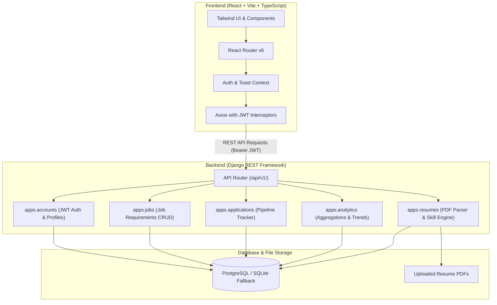

# CareerLens — Smart Job Application & Skill Gap Analyzer

[](https://www.python.org/)
[](https://www.djangoproject.com/)
[](https://react.dev/)
[](https://www.typescriptlang.org/)
[](https://tailwindcss.com/)
[](https://www.docker.com/)

---

## 📌 1. Project Overview

**CareerLens** is a production-minded full-stack web application designed for students and software engineers to optimize their job hunt. It bridges the gap between candidate resumes and modern job postings by extracting technical skills from uploaded PDF resumes, calculating transparent skill match percentages against target job descriptions, generating curated learning roadmaps for missing requirements, and providing a full application pipeline tracker with real-time analytics.

> **Disclaimer:** CareerLens provides algorithmic skill matching and educational roadmaps for preparation. It does not guarantee employment, predict hiring decisions, or evaluate real-world candidate competence.

---

## 🚀 2. Key Features

- **🔐 Secure Authentication & User Isolation:** Full JWT authentication with auto-refreshing access tokens, ownership checks on all private resources, and custom user profiles.
- **📄 Safe PDF Resume Parsing:** Integrated **PyMuPDF** engine to extract text across pages with robust handling for encrypted, corrupted, and scanned/empty PDFs.
- **🧠 Token-Aware Skill Extraction:** Recognizes 100+ technologies and normalizes common aliases (e.g., `js` → `JavaScript`, `postgres` → `PostgreSQL`, `k8s` → `Kubernetes`, `drf` → `Django`).
- **🎯 Transparent Match Scoring:**
  $$\text{Match Score} = \left(\frac{\text{Matched Required Skills}}{\text{Total Required Skills}}\right) \times 100$$
  Includes TF-IDF Cosine Similarity for document wording comparison.
- **📚 Curated Learning Recommendations:** Generates beginner-friendly explanations, step-by-step learning sequences, portfolio project ideas, and verified official documentation links for any missing required skills.
- **📋 Job Application Pipeline Tracker:** Switchable **Kanban Board** and **Interactive Table** to track applications through Wishlist, Applied, Assessment, Interview, Offer, Rejected, and Withdrawn stages.
- **📊 Real-time Candidate Analytics:** Visualizes application timelines, pipeline conversion funnels, match score distributions, and highest-frequency missing skills using **Recharts**.

---

## 🏗️ 3. System Architecture



---

## 📂 4. Project Structure

```text
careerlens/
├── backend/
│   ├── config/                     # Django core settings, URLs, WSGI, ASGI
│   │   ├── settings.py
│   │   ├── urls.py
│   │   └── wsgi.py
│   ├── apps/
│   │   ├── accounts/               # Auth, registration, JWT, profiles
│   │   ├── resumes/                # Resume uploads, PyMuPDF parser, skill matching engine
│   │   │   └── services/
│   │   │       └── skill_engine.py # Skill catalog, normalization, recommendations
│   │   ├── jobs/                   # Job descriptions & requirement extraction
│   │   ├── applications/           # Job application Kanban & status pipeline
│   │   └── analytics/              # Aggregations, funnel metrics, skill demand
│   ├── manage.py
│   ├── requirements.txt
│   ├── .env.example
│   └── Dockerfile
├── frontend/
│   ├── src/
│   │   ├── api/                    # Centralized Axios client & typed service modules
│   │   ├── components/             # Reusable UI (Cards, Badges, Modals, Spinners, Layouts)
│   │   ├── context/                # AuthContext & ToastContext
│   │   ├── pages/
│   │   │   ├── auth/               # Login & Register
│   │   │   ├── dashboard/          # Analytics Overview & Quick Actions
│   │   │   ├── resumes/            # Drag-and-drop Upload & Skill Inspector
│   │   │   ├── jobs/               # Job Description Management
│   │   │   ├── analysis/           # Skill Gap Analyzer & Learning Roadmap
│   │   │   ├── applications/       # Kanban & Table Application Tracker
│   │   │   ├── analytics/          # Detailed Conversion & Skill Trends
│   │   │   └── profile/            # Career Goals & Seniority Settings
│   │   ├── types/                  # TypeScript interface declarations
│   │   ├── App.tsx
│   │   ├── main.tsx
│   │   └── index.css
│   ├── package.json
│   ├── tailwind.config.js
│   ├── vite.config.ts
│   ├── nginx.conf
│   └── Dockerfile
├── docker-compose.yml
├── .gitignore
└── BUILD_STATUS.md
```

---

## 🗄️ 5. Database Models Overview

| Model | Application | Description |
| :--- | :--- | :--- |
| **`User`** | `auth` | Django standard authentication model. |
| **`UserProfile`** | `accounts` | Extended profile with `target_role`, `experience_level`, and `headline`. |
| **`Resume`** | `resumes` | Uploaded PDF file, extracted plain text, identified skill list, status, page count. |
| **`SkillAnalysis`** | `resumes` | Snapshot of calculated match score, text similarity, matched/missing skills, and learning roadmap. |
| **`JobDescription`** | `jobs` | Target role, company, employment type, location, required & preferred skills. |
| **`JobApplication`** | `applications` | Pipeline entry (`wishlist`, `applied`, `assessment`, `interview`, `offer`, `rejected`, `withdrawn`), dates, salary, notes. |

---

## 🌐 6. Versioned REST API Overview

All API endpoints are versioned under `/api/v1/`:

| Method | Endpoint | Description |
| :--- | :--- | :--- |
| `POST` | `/api/v1/auth/register/` | Register new user and return JWT tokens |
| `POST` | `/api/v1/auth/login/` | Log in with credentials and obtain JWT tokens |
| `POST` | `/api/v1/auth/refresh/` | Refresh expired access token |
| `GET`/`PATCH` | `/api/v1/auth/me/` | Retrieve and update authenticated user profile |
| `GET`/`POST` | `/api/v1/resumes/` | List user resumes / Upload and parse new PDF |
| `GET`/`DELETE` | `/api/v1/resumes/{id}/` | Inspect or delete a resume |
| `POST` | `/api/v1/resumes/{id}/reprocess/` | Re-run text extraction & skill catalog matching |
| `GET`/`POST` | `/api/v1/jobs/` | List user jobs / Create new job description |
| `POST` | `/api/v1/jobs/extract-preview/` | Preview extracted skills from raw text |
| `GET`/`PATCH`/`DELETE`| `/api/v1/jobs/{id}/` | Retrieve, edit, or delete job description |
| `GET`/`POST` | `/api/v1/analyses/` | List past analyses / Run new Skill Gap Analysis |
| `GET`/`DELETE` | `/api/v1/analyses/{id}/` | View specific analysis results and roadmap |
| `GET`/`POST` | `/api/v1/applications/` | List applications (with filters) / Create new application |
| `GET`/`PATCH`/`DELETE`| `/api/v1/applications/{id}/` | Retrieve, edit, or delete application |
| `PATCH` | `/api/v1/applications/{id}/status/` | Quick status transition (for Kanban drag/drop) |
| `GET` | `/api/v1/analytics/overview/` | KPI counts, recent applications, average match score |
| `GET` | `/api/v1/analytics/applications/` | Pipeline breakdown & monthly timeline |
| `GET` | `/api/v1/analytics/skills/` | Most frequently missing and matched skills |

---

## 💻 7. Local Setup (Windows PowerShell)

### Prerequisites
- **Python 3.11+** installed (`python --version`)
- **Node.js 18+** installed (`node --version`)

---

### Step 1: Backend Setup

Open Windows PowerShell in the project directory:

```powershell
# 1. Navigate to project root
cd c:\Users\HP\OneDrive\Documents\DJ

# 2. Create and activate Python virtual environment
python -m venv backend\venv
.\backend\venv\Scripts\Activate.ps1

# 3. Install Python dependencies
pip install -r backend\requirements.txt

# 4. Copy environment settings
Copy-Item backend\.env.example backend\.env

# 5. Run database migrations (SQLite fallback is enabled by default)
python backend\manage.py migrate

# 6. (Optional) Create Django admin superuser
python backend\manage.py createsuperuser

# 7. Start the Django development server
python backend\manage.py runserver 127.0.0.1:8000
```

The backend will be accessible at `http://127.0.0.1:8000`.

---

### Step 2: Frontend Setup

Open a **second** Windows PowerShell terminal:

```powershell
# 1. Navigate to the frontend directory
cd c:\Users\HP\OneDrive\Documents\DJ\frontend

# 2. Install Node dependencies
npm install

# 3. Start the Vite development server
npm run dev
```

The frontend will be accessible at `http://localhost:5173`.

---

## 🐳 8. Docker Compose Setup (Production-Ready)

To run the entire stack (PostgreSQL Database + Django Backend + React Nginx Frontend) with Docker:

```powershell
# Build and launch all services in detached mode
docker-compose up --build -d

# View status
docker-compose ps

# View backend logs
docker-compose logs -f backend
```

- **Frontend Application:** `http://localhost`
- **Backend API:** `http://localhost:8000/api/v1/`
- **Django Admin:** `http://localhost:8000/admin/`

---

## 🧪 9. Running Tests

### Backend Automated Test Suite
To run all 17 backend unit and integration tests:

```powershell
.\backend\venv\Scripts\python backend\manage.py test apps
```

**Test Coverage Highlights:**
- User registration, password matching, and JWT token issuance
- Unauthorized access rejection on private endpoints
- Real in-memory PDF generation and PyMuPDF text parsing
- Token-aware skill extraction (verifying boundary checks for `C`, `Go`, `CSS`, `React`, `Python`)
- Skill alias normalization (`js` → `JavaScript`, `postgres` → `PostgreSQL`, `k8s` → `Kubernetes`)
- Transparent formula accuracy: `(Matched Required / Total Required) * 100`
- Safe handling when job descriptions have empty required skills
- Curated learning roadmap and official documentation links
- Job application CRUD, status transitions, and user data isolation
- Analytics overview aggregations and skill frequency counters

### Frontend Production Build Verification
To compile and type-check the React application:

```powershell
cd frontend
npm run build
```

---

## 🔒 10. Security & Best Practices

- **Strict User Isolation:** All querysets are filtered by `owner=request.user`. Users cannot view, modify, or delete another user's resumes, jobs, analyses, or applications.
- **File Validation:** Restricts uploads strictly to `.pdf` format with a 5MB size limit. PyMuPDF extracts text safely without executing uploaded binaries.
- **Safe Password Storage:** Uses Django's default PBKDF2 with SHA-256 password hashing.
- **CORS Configuration:** Restricted to configured frontend origins.
- **Zero Hardcoded Secrets:** All secrets, keys, and database credentials are read from `.env`.

---

## 🗺️ 11. Future Roadmap

- [ ] Export skill gap analysis as a downloadable PDF report.
- [ ] OCR integration for scanned image-based PDF resumes (Tesseract).
- [ ] Email notifications for upcoming interview rounds.
- [ ] Resume version comparison against historical score benchmarks.

---

## 📄 License
This project is open-source and available under the **MIT License**.
